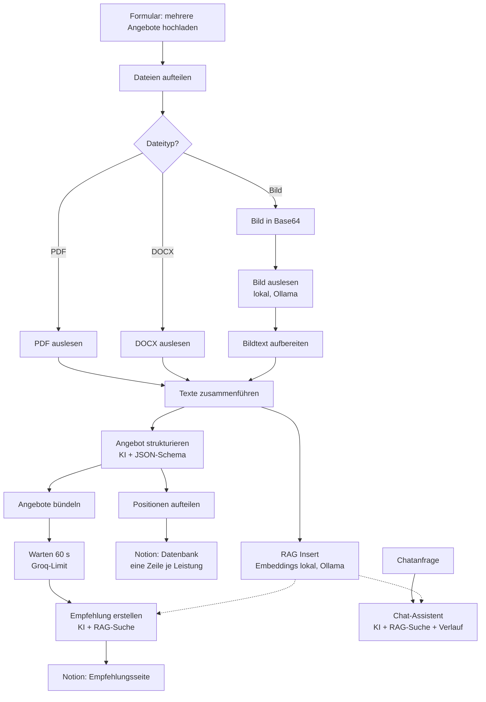
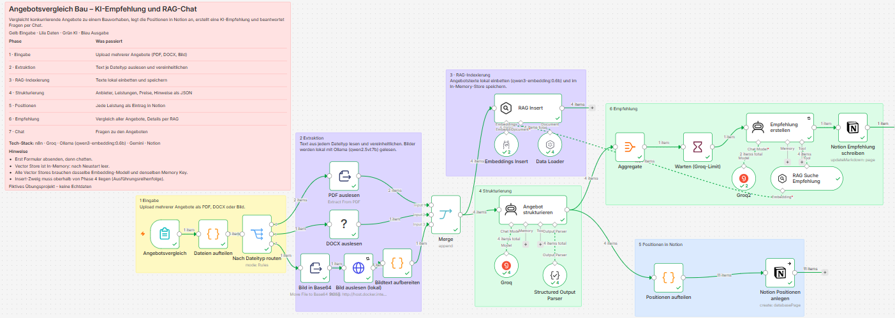
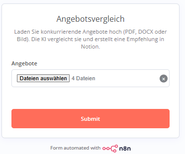
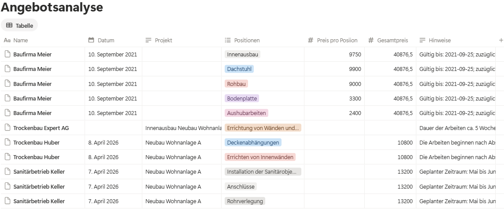
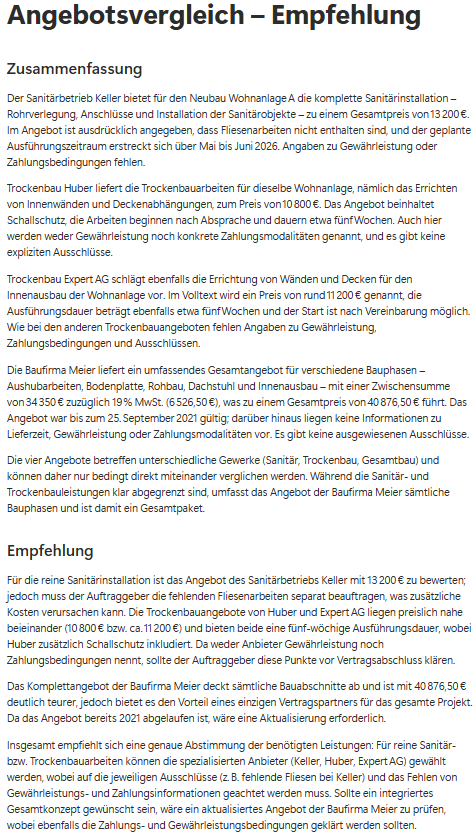
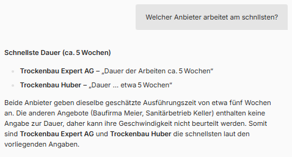
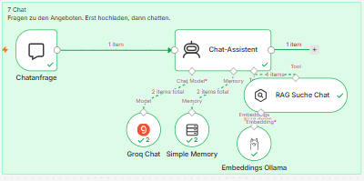

# Angebotsvergleich Bau – KI-Empfehlung, Notion und RAG-Chat

> Ein n8n-Workflow, der konkurrierende Bauangebote als PDF, Word-Datei oder Foto einliest, die Positionen strukturiert in Notion ablegt, eine KI-Empfehlung schreibt und Rückfragen per RAG-Chat beantwortet.

Angebote zu einem Bauvorhaben kommen in unterschiedlichen Formaten. Wer sie vergleichen will, tippt Positionen ab und übersieht leicht das Kleingedruckte, etwa „ohne Fliesenarbeiten“. Dieser Workflow nimmt das Abtippen ab, macht Ausschlüsse, Gültigkeit und fehlende Angaben sichtbar und lässt sich per Chat befragen. **Die Vergabe trifft weiterhin ein Mensch.**

**Leitgedanke:** *Die KI vergleicht – der Mensch vergibt.*

📄 **Überblick in 15 Folien:** [Präsentation (PDF)](docs/praesentation.pdf)

## Meine Rolle

Den Workflow habe ich selbst konzipiert, gebaut und getestet, um zu verstehen, was RAG (Retrieval-Augmented Generation) in einem fachlichen Ablauf tatsächlich leistet – und wo es keinen Mehrwert bringt.

- **Workflow-Design:** Upload mehrerer Dateitypen, Extraktion je Format, strukturierte Ausgabe per JSON-Schema, zwei Notion-Ausgaben, Chat
- **RAG umgesetzt:** lokale Embeddings über Ollama, Vector Store als Tool für zwei Agenten
- **Schrittweise weiterentwickelt:** fünf Ausbaustufen, jede begründet – zuletzt Bilder lokal statt über Gemini (siehe [Entwicklung des Workflows](#entwicklung-des-workflows))
- **Testen und Fehler beheben:** neun Befunde dokumentiert, acht behoben, offene Punkte benannt – siehe [Testprotokoll](docs/testprotokoll.md)
- **Bewusste Abwägungen:** Cloud-Sprachmodell vs. lokales Modell, In-Memory-Store vs. dauerhafte Datenbank, Token-Limits

## Kontext

Übungsprojekt zum Aufbau eines RAG-Workflows in n8n. Der Workflow ist real gebaut und getestet.

**Testangebote:** Die Angebote, mit denen getestet wurde, hat die **Werkskolleg GmbH für berufliche Qualifizierung** als Bildungseinrichtung zur Verfügung gestellt. Das Urheberrecht liegt bei der Werkskolleg GmbH. Firmen, Angebote und Beträge darin sind fiktiv. Die Originaldateien sind deshalb **nicht** Teil dieses Repositorys; Screenshots zeigen nur, was der Workflow daraus gemacht hat.

---

## Inhalt

- [Ablauf](#ablauf)
- [Ergebnisse](#ergebnisse)
- [Technik](#technik)
- [Repository-Struktur](#repository-struktur)
- [Einrichtung](#einrichtung)
- [Entwicklung des Workflows](#entwicklung-des-workflows)
- [Design-Entscheidungen](#design-entscheidungen)
- [Offene Punkte und Grenzen](#offene-punkte-und-grenzen)
- [Hinweise](#hinweise)

---

## Ablauf





*Der Workflow in n8n. Die Farben der Notizen folgen einem festen Schema: Gelb Eingabe · Lila Daten & Wissen · Grün KI-Agenten · Blau Ausgabe nach Notion.*

| Phase | Was passiert |
|---|---|
| 1 · Eingabe | Formular nimmt mehrere Dateien an, eine Code-Node macht daraus einzelne Items |
| 2 · Extraktion | Switch routet nach Dateityp; PDF, DOCX und Bild werden zu einem einheitlichen Feld `text`. Bilder liest ein lokales Vision-Modell (Ollama) |
| 3 · RAG-Indexierung | Volltexte werden lokal eingebettet und im In-Memory-Vector-Store gespeichert, Anbietername als Metadaten |
| 4 · Strukturierung | KI-Agent extrahiert Anbieter, Datum, Projekt, Leistungen, Preise und Hinweise nach JSON-Schema |
| 5 · Positionen | Jede Leistung wird ein Eintrag in der Notion-Datenbank |
| 6 · Empfehlung | KI-Agent vergleicht alle Angebote und prüft Details per RAG im Originaltext |
| 7 · Chat | Chat-Agent beantwortet Fragen zu den Angeboten aus dem Vector Store |

**Wichtig zur Reihenfolge:** n8n führt parallele Zweige von oben nach unten aus. Der Zweig *RAG Insert* liegt deshalb auf der Arbeitsfläche oberhalb der Strukturierung – so ist der Vector Store gefüllt, bevor die Empfehlung ihn abfragt.

## Ergebnisse

**Upload und Positionen in Notion**





**KI-Empfehlung** – behandelt alle vier Anbieter, darunter das lokal ausgelesene Foto-Angebot. Sie benennt Ausschlüsse mit Folgekosten (Sanitärbetrieb Keller ohne Fliesenarbeiten), erkennt ein veraltetes Angebot (Baufirma Meier, nur bis 25.09.2021 gültig), wägt Preis und Leistung der Trockenbauangebote ab und weist darauf hin, dass die Angebote verschiedene Gewerke betreffen – Einzelvergabe oder Gesamtpaket muss der Mensch entscheiden. Per RAG geprüft: Kein Angebot nennt Gewährleistung oder Zahlungsbedingungen – das soll vor Vertragsschluss geklärt werden.



**RAG-Chat**





Beispielfragen:
- Welcher Anbieter arbeitet am schnellsten?
- Welche Leistungen schließt der Sanitärbetrieb aus?
- Welches Angebot ist nicht mehr gültig?
- Bietet jemand Malerarbeiten an? *(soll antworten, dass das nicht in den Angeboten steht)*

## Technik

| Baustein | Aufgabe |
|---|---|
| [n8n](https://n8n.io) | Steuert den Ablauf (Form Trigger, Code, Switch, Extract from File, HTTP Request, Merge, AI Agent, Aggregate, Wait, Notion, Chat Trigger) |
| Groq (`openai/gpt-oss-120b`) | Sprachmodell für Strukturierung, Empfehlung und Chat |
| Ollama (`qwen2.5vl:7b`) | Liest Text aus Angebotsfotos (PNG, JPG) lokal – per HTTP Request an `/api/generate` |
| Ollama (`qwen3-embedding:0.6b`) | Lokale Embeddings für den Vector Store |
| n8n Simple Vector Store | In-Memory-Vector-Store (Insert und Retrieve as Tool) |
| Simple Memory | Gesprächsverlauf im Chat, damit Folgefragen verstanden werden |
| Notion | Datenbank „Angebotsanalyse“ und Seite „Angebotsvergleich – Empfehlung“ |
| Community-Node `n8n-nodes-docx-converter` | Liest Word-Dateien (DOCX) |

## Repository-Struktur

```
├── README.md
├── LICENSE
├── workflow/
│   └── angebotsvergleich-rag.json   # n8n-Export, ohne Zugangsdaten, Notion-IDs als Platzhalter
├── notion/
│   └── datenbank-schema.md          # Spalten der Datenbank und Aufbau der Empfehlungsseite
├── docs/
│   ├── praesentation.pdf
│   └── testprotokoll.md
├── beispieldaten/                   # Hinweis zu den Testdaten und Aufbau eigener Beispielangebote
└── images/
    ├── workflow-n8n.png
    ├── formular.png
    ├── notion-positionen.png
    ├── notion-empfehlung.png
    ├── chat.png
    └── chat-logs.png
```

## Einrichtung

1. **n8n** selbst gehostet starten (z. B. per Docker). Die Community-Node `n8n-nodes-docx-converter` installieren (*Settings → Community Nodes*).
2. **Ollama** installieren und beide Modelle laden:
   ```
   ollama pull qwen3-embedding:0.6b
   ollama pull qwen2.5vl:7b
   ```
   Läuft n8n in Docker, muss Ollama aus dem Container erreichbar sein (z. B. `http://host.docker.internal:11434`). Diese Adresse steht auch in der Node *Bild auslesen (lokal)* – bei anderer Installation dort anpassen.
3. Workflow importieren: *Workflows → Import from File* → `workflow/angebotsvergleich-rag.json`.
4. **Zugangsdaten anlegen** (werden nicht mitgeliefert) und in den Nodes auswählen:
   - Groq API-Key – Nodes *Groq*, *Groq2*, *Groq Chat*
   - Ollama – Nodes *Embeddings Insert*, *Embeddings Ollama* (die Bild-Node braucht keinen Key)
   - Notion-Integration (notion.so/my-integrations), mit Datenbank und Seite verbunden – beide Notion-Nodes
5. **Notion vorbereiten** (Schema: [`notion/datenbank-schema.md`](notion/datenbank-schema.md)):
   - Datenbank „Angebotsanalyse“ anlegen, ID in *Notion Positionen anlegen* statt `NOTION_DATENBANK_ID_ANGEBOTSANALYSE` eintragen
   - Seite „Angebotsvergleich – Empfehlung“ anlegen, ID in *Notion Empfehlung schreiben* statt `NOTION_SEITEN_ID_EMPFEHLUNG` eintragen
6. **Testen:** *Execute workflow*, im Formular eigene Angebote hochladen (Aufbau siehe [`beispieldaten/LIESMICH.md`](beispieldaten/LIESMICH.md)). Nach dem Lauf über *Open chat* Fragen stellen.

> **Hinweis:** Erst hochladen, dann chatten. Der Vector Store liegt im Arbeitsspeicher und ist nach einem Neustart von n8n leer. Alle drei Vector-Store-Nodes nutzen denselben Memory Key (`vector_store_key`) und dasselbe Embedding-Modell.

## Entwicklung des Workflows

Der Workflow ist in fünf Stufen gewachsen. Jede Stufe wurde einzeln gebaut, getestet und begründet.

| Stufe | Was | Warum |
|---|---|---|
| 1 · Basis | Upload, Extraktion je Format (Bilder über Google Gemini), Strukturierung per JSON-Schema, Notion-Datenbank und Empfehlung | Abtippen ersetzen, Angebote vergleichbar machen |
| 2 · RAG | Lokale Embeddings (Ollama), Vector Store als Tool des Empfehlungs-Agenten | Details im Originaltext prüfen. Ein lokales Chat-Modell scheiterte am JSON-Schema – die Sprachmodelle blieben bei Groq |
| 3 · RAG-Chat | Chat-Agent mit Vector Store und Gesprächsverlauf | Freie Rückfragen – hier bringt RAG den größten Nutzen |
| 4 · Robust | Datumsformat, Projekt-Zuordnung, JPG-Erkennung, Wait 60 s, Retry On Fail | Befunde aus den Tests beheben ([Testprotokoll](docs/testprotokoll.md)) |
| 5 · Bilder lokal | Ollama (`qwen2.5vl:7b`) liest Fotos statt Gemini | Gemini fiel im Test mehrfach aus; die Bilddatei bleibt auf dem eigenen Rechner |

### Verbesserung: Bilder lokal lesen statt über Gemini

| | Vorher: Google Gemini | Nachher: Ollama lokal (`qwen2.5vl:7b`) |
|---|---|---|
| Wo wird gelesen? | Cloud-Dienst von Google | Auf dem eigenen Rechner |
| Datenschutz | Bilddatei geht an Google | **Bilddatei verlässt den Rechner nicht** |
| Verfügbarkeit im Test | Mehrfach „Service unavailable“ (503), auch nach Modellwechsel | **Unabhängig von externen Ausfällen** |
| Modellwechsel | Modelle werden abgekündigt (z. B. `gemini-2.5-flash`) | Modellversion bleibt, bis man sie selbst ändert |
| API-Key | Google-Key nötig | Kein zusätzlicher Key |
| Geschwindigkeit | Sekunden | Langsamer – im Test mehrere Minuten pro Bild |
| Ressourcen | Keine lokale Last | Modell ca. 6 GB, belastet den Rechner |

**Umbau:** *Extract from File* (Move File to Base64 String) → *HTTP Request* (POST an Ollama `/api/generate`, Bild im Feld `images`) → *Bildtext aufbereiten* liest jetzt das Feld `response`. Die übrigen Phasen blieben unverändert, weil alle Wege weiterhin ein Feld `text` liefern.

**Grenze:** Der ausgelesene Text geht – wie bei PDF und DOCX – weiter an Groq. Ganz lokal wäre der Workflow erst mit einem lokalen Sprachmodell.

## Design-Entscheidungen

| Entscheidung | Warum | Preis dafür |
|---|---|---|
| Groq für die Sprachmodelle | Ein lokales Modell über Ollama hielt das JSON-Schema nicht zuverlässig ein („Model output doesn't fit required format“) | Angebotstexte gehen an einen Cloud-Dienst |
| Embeddings lokal (`qwen3-embedding:0.6b`) | Klein, schnell, gut mit Deutsch; Einbettung ohne Cloud | Ollama muss laufen |
| Simple Vector Store (In-Memory) | Keine Zusatzinfrastruktur, für eine Demo ausreichend | Nach Neustart leer |
| Store bei jedem Upload leeren (*Clear Store*) | Angebote verschiedener Bauvorhaben dürfen sich nicht mischen | Keine Historie |
| Insert-Zweig oberhalb der Analyse | n8n führt Zweige von oben nach unten aus | Die Position auf der Arbeitsfläche ist Logik |
| Bilder lokal mit Ollama (`qwen2.5vl:7b`) | Unabhängig von Gemini; Bilddatei bleibt auf dem Rechner | Langsamer, braucht Rechenleistung |
| Wait 60 s vor der Empfehlung | Groq Free Tier: 8.000 Tokens pro Minute | Ein Lauf dauert eine Minute länger |
| Upload und Chat in einem Workflow | Der In-Memory-Store wird nicht zuverlässig über Workflows hinweg geteilt | Ein größerer Workflow |

**Ehrlich bewertet:** Die Testangebote sind kurz – ihr Volltext würde auch direkt in den Prompt passen. RAG wird hier vor allem als Muster gezeigt. Echten Mehrwert bringt es mit langen Leistungsverzeichnissen, Vergabekriterien oder einer Historie früherer Angebote.

## Offene Punkte und Grenzen

- **Mengengerüst:** Bei 8 Dateien läuft die Strukturierung ins Token-Limit von Groq und verliert Angebote. Getestet und demonstriert mit 4–5 Dateien. Nächster Schritt: *Loop Over Items* in kleinen Paketen mit Wait, *Retry On Fail*.
- **Externe Dienste:** Groq und Notion können ausfallen (Gemini ist bereits durch Ollama ersetzt). Nächster Schritt: Retry On Fail an allen KI-Nodes und ein Fehler-Workflow.
- **Datenschutz:** Bilder bleiben lokal, die ausgelesenen Angebotstexte gehen aber an Groq. Für vertrauliche Angebote ein größeres lokales Sprachmodell testen (z. B. `qwen2.5:14b`).
- **Persistenz:** Der In-Memory-Store ist nach einem Neustart leer. Für eine Angebotshistorie: Qdrant per Docker.

## Hinweise

- Lern- und Demonstrationsprojekt, **nicht für den Produktiveinsatz** ohne eigene Prüfung von Datenschutz und Informationssicherheit.
- Testangebote: bereitgestellt von der Werkskolleg GmbH für berufliche Qualifizierung, Urheberrecht beim Herausgeber. Firmen, Angebote und Beträge darin sind fiktiv.
- Die KI-Empfehlung ist eine Entscheidungsvorlage, keine Vergabeentscheidung.

## Lizenz

Code und Workflows: MIT-Lizenz (siehe [`LICENSE`](LICENSE)). Dokumentation (Texte, Präsentation, Bilder): [CC BY 4.0](https://creativecommons.org/licenses/by/4.0/deed.de). Ausgenommen sind die Inhalte der Testangebote (Anbieter, Leistungen, Preise), die in Screenshots und Beispielen erscheinen – sie gehören der Werkskolleg GmbH für berufliche Qualifizierung und fallen nicht unter diese Lizenzen.
